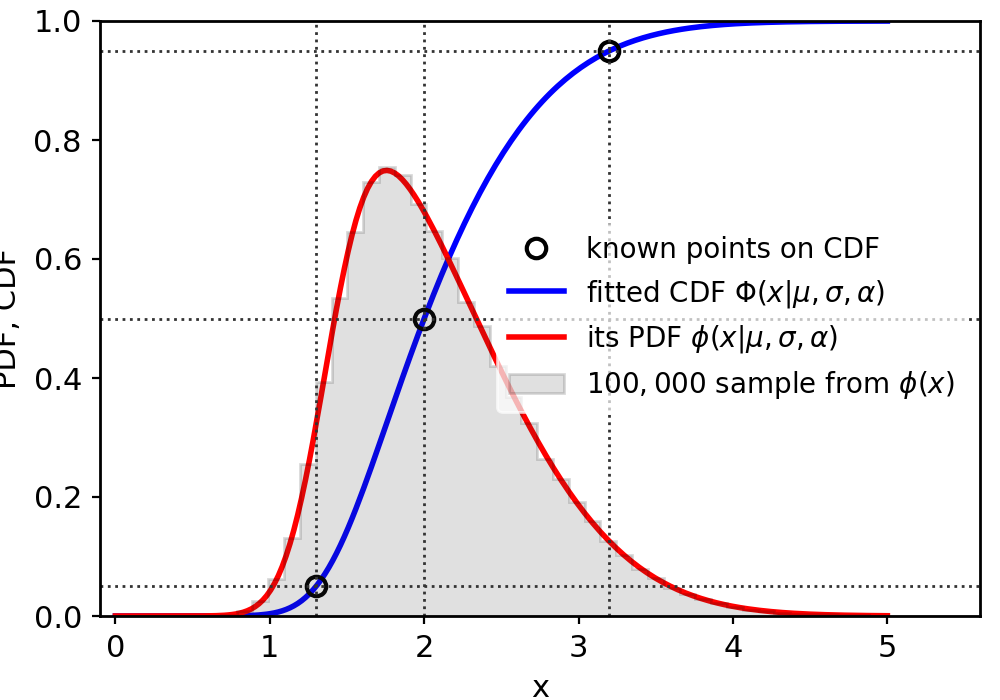

skewnormal
==========

**Author:** Robert Nikutta

**Version:** 2026.05

**License:** BSD 3-clause, see [LICENSE](./LICENSE).

Estimate the free parameters `(mu, sigma, alpha)` of a Skew-Normal PDF
from a measured median and (possibly asymmetric) spread.  The
`SkewNormal` class provides `.pdf()`, `.cdf()`, and `.rvs()` for
evaluation and sampling.

### Dependencies

`numpy`, `scipy ≥ 1.4`.

### Worked example

[example.py](./example.py) reproduces the figure above:

    $ python3 example.py

### API

    import skewnormal

    # Recover (mu, sigma, alpha) from a measured median + asymmetric errors
    mu, sigma, alpha = skewnormal.get_skewnormal_parameters(
        xM=2.1, dL=0.8, dR=1.3, fraction=0.9)

    # Build the distribution
    sn = skewnormal.SkewNormal(mu, sigma, alpha)

    # Draw a sample
    sample = sn.rvs(size=100_000)

    # Evaluate PDF / CDF
    y = sn.pdf(x)
    F = sn.cdf(x)
